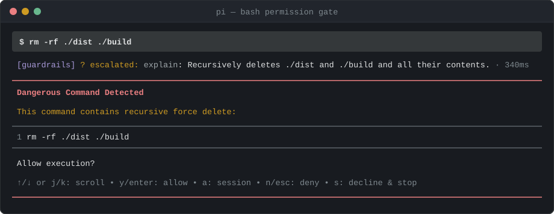

# pi-guardrails-explain

Pi extension that explains Guardrails-gated Bash commands before you approve or deny them.

When [@aliou/pi-guardrails](https://github.com/aliou/pi-guardrails) flags a Bash command for human confirmation, this extension asks a chat model for a one-line explanation of what the command does and shows it in Guardrails' `[guardrails]` decision entry before the usual confirmation prompt. The decision is always yours: the extension never allows or blocks a command.



## Requirements

- Node.js **22.19.0 or newer** (Pi 1.5.2's minimum supported Node version).
- Pi 1.5.x (the extension API and model registry come from the Pi runtime).
- `@aliou/pi-guardrails` **0.23.0 or newer** — decision delegation was added in 0.23.0; older Guardrails versions will not call the delegate.
- At least one model authenticated in Pi (the active session model works by default).

## Install

```bash
pi install git:github.com/pcaro/pi-guardrails-explain
```

Then start Pi (or run `/reload` in an existing session). There is no build step; the package ships plain TypeScript that Pi loads directly. To try it once without installing, use `pi -e git:github.com/pcaro/pi-guardrails-explain`.

## Configure the explainer model and language

Optional. Set `guardrailsExplain` in `~/.pi/agent/settings.json` with an ordered list of `provider/modelId` candidates and an optional response `language` (defaults to `"English"`):

```json
{
  "guardrailsExplain": {
    "models": ["provider-a/fast-model", "provider-b/small-model"],
    "language": "Spanish"
  }
}
```

Candidates are tried in order:

1. The configured specs, skipping any whose provider credentials are not configured in Pi.
2. The **active session model** is always tried last unless it is already in the list. If the setting is absent or none of its models is available, the active model is the only candidate.

If a model request fails, the next candidate is tried. If all requests fail before Guardrails' deadline, the delegate returns its generic explanation fallback and the ordinary confirmation prompt still appears.

## Behavior

- **Bash only.** Only Bash commands that Guardrails' permission gate already prompts you about reach the explainer. File/path-access prompts, PowerShell, and commands Guardrails does not flag are untouched.
- **`[guardrails]` explanation line.** The explanation appears as the delegate reason in Guardrails' decision entry (for example `[guardrails] ? escalated: explain: …`). If all candidates fail before the shared deadline, the entry gets a generic fallback reason. If the deadline expires first, Guardrails marks the delegate as timed out. Both cases still show Guardrails' ordinary confirmation prompt.
- **Always human.** The delegate always answers `ask`. The model only describes the command in a short one-line summary in `guardrailsExplain.language` (default `"English"`); it never decides. Guardrails' confirmation prompt still appears, and your answer is the only thing that allows or blocks the command.
- **Session cache.** Successful explanations are cached in memory for the current session (up to 64 commands, cleared on shutdown or reload) so repeated commands do not trigger duplicate model requests.
- **No session history.** The extension sends only the raw command text plus Guardrails' own flagged reason to the selected model. Conversation history is never transmitted.

## Privacy

The raw Bash command (and Guardrails' short risk reason) is sent to each provider the extension tries. Commands can contain secrets. `guardrailsExplain.models` is a preference list, not a provider allowlist: if every configured request fails, the active session model is tried last and may send the command to another provider. For a strict provider boundary, keep the active model within the approved provider set too, or remove the package with `pi remove git:github.com/pcaro/pi-guardrails-explain`. Nothing else about your session leaves the machine.

## Slow providers

Guardrails runs decision delegates under a shared deadline that defaults to **10 seconds** (hard-capped at 60 seconds). A slow model may not answer in time; the explanation is then lost and the normal prompt is shown. If your provider is slow, raise the deadline in **your own** Guardrails configuration (`~/.pi/agent/extensions/guardrails.json`):

```json
{
  "delegation": {
    "timeoutMs": 30000
  }
}
```

This repository never changes that setting for you; it belongs to your Guardrails config.

## Development

```bash
npm install
npm run typecheck
npm test
```

`npm test` covers the package manifest and documentation, model selection, explanation fallback/formatting, and delegate registration and approval behavior.

## License

[MIT](./LICENSE)
